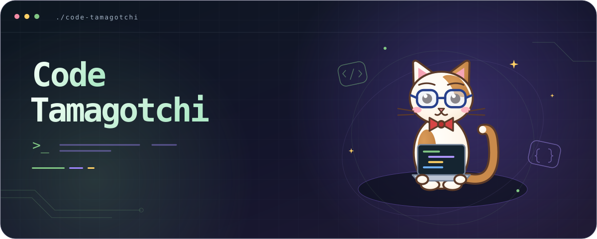
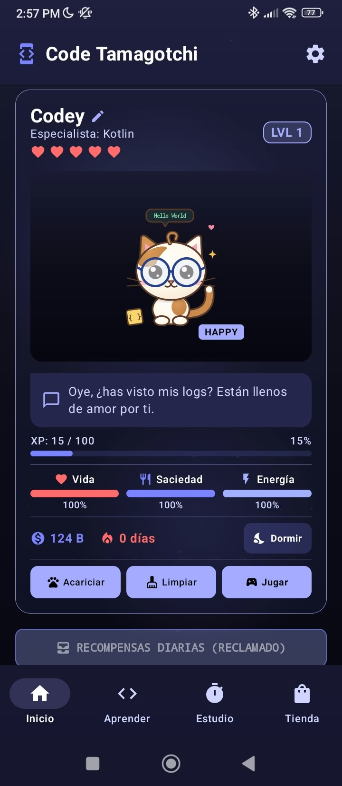
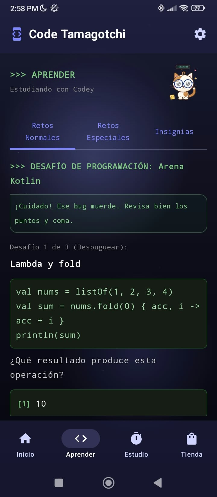
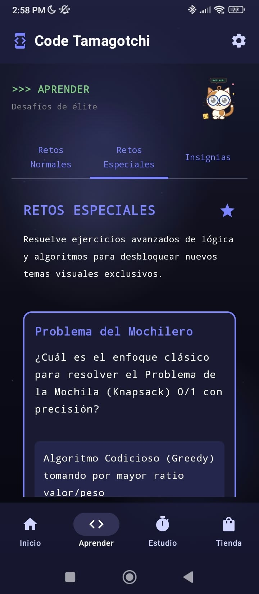
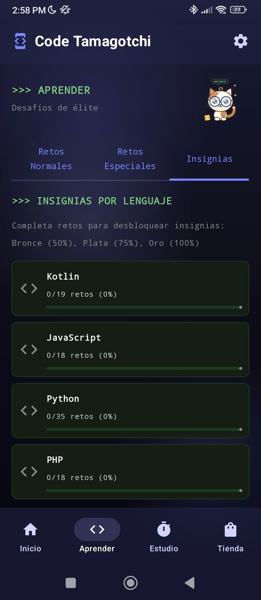
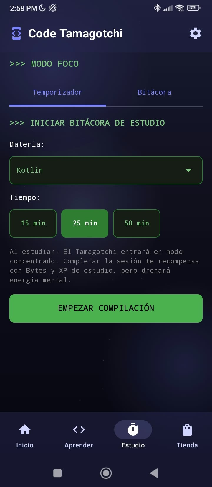
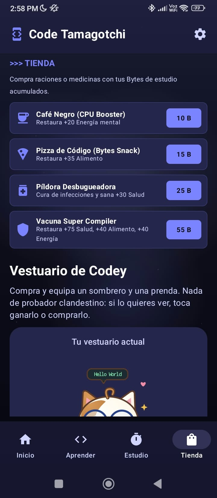
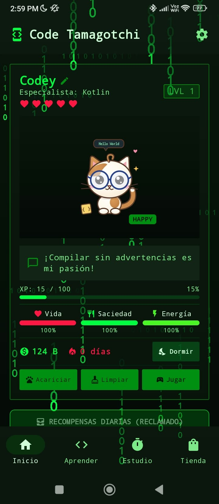

<div align="center">
  

  <h1>Code Tamagotchi</h1>

  <p><strong>Cría a Codey mientras aprendes a programar.</strong></p>
  <p>Pomodoro, retos de código, juegos arcade y cuidado de mascota en una app Android local-first.</p>

  <p>
    <a href="https://github.com/fguzman-stack/CodePet/releases/latest"></a>
    <a href="#capturas"></a>
  </p>

  <p>
    <a href="https://github.com/fguzman-stack/CodePet/releases"></a>
    <a href="LICENSE"></a>
    
    
    
  </p>

  <p><a href="README.md">English</a> · <strong>Español</strong></p>
</div>

---

<div align="center">
  <a href="#capturas">Capturas</a> ·
  <a href="#funciones">Funciones</a> ·
  <a href="#instalacion">Instalación</a> ·
  <a href="#documentacion">Documentación</a> ·
  <a href="#contribuir">Contribuir</a>
</div>

---

## Qué Es

Code Tamagotchi convierte la práctica de programación en un ciclo de cuidado. Estudia con Pomodoro, resuelve retos de código, gana XP y Bytes, y usa esas recompensas para mantener a Codey sano, descansado y evolucionando.

```text
estudiar -> resolver -> ganar -> cuidar -> desbloquear -> repetir
```

La app está construida para Android con Kotlin, Jetpack Compose, Room, DataStore, Koin y WorkManager.

<a id="capturas"></a>
## Capturas

Las capturas del proyecto viven en [`capturas_de_pantalla/`](capturas_de_pantalla/) y se muestran aquí en el mismo orden de la carpeta.

<div align="center">
<table>
<tr>
<td align="center" width="33%"><a href="capturas_de_pantalla/captura_1.jpeg"></a><br/><sub><strong>01</strong> · Inicio y cuidados</sub></td>
<td align="center" width="33%"><a href="capturas_de_pantalla/captura_2.jpeg"></a><br/><sub><strong>02</strong> · Retos de código</sub></td>
<td align="center" width="33%"><a href="capturas_de_pantalla/captura_3.jpeg"></a><br/><sub><strong>03</strong> · Retos especiales</sub></td>
</tr>
<tr>
<td align="center" width="33%"><a href="capturas_de_pantalla/captura_4.jpeg"></a><br/><sub><strong>04</strong> · Insignias por lenguaje</sub></td>
<td align="center" width="33%"><a href="capturas_de_pantalla/captura_5.jpeg"></a><br/><sub><strong>05</strong> · Modo foco</sub></td>
<td align="center" width="33%"><a href="capturas_de_pantalla/captura_6.jpeg"></a><br/><sub><strong>06</strong> · Tienda y vestuario</sub></td>
</tr>
</table>

<a href="capturas_de_pantalla/captura_7.jpeg"></a><br/>
<sub><strong>07</strong> · Tema Matrix Green</sub>
</div>

<a id="funciones"></a>
## Funciones

<table>
<tr>
<td width="50%" valign="top">

### Cuidado De Mascota

- Estados dinámicos para felicidad, sueño, estudio, enfermedad, hambre, tristeza, emoción y momentos críticos.
- Vida, saciedad, energía, XP, Bytes y racha.
- Acciones para dormir, limpiar, acariciar y comprar recursos.
- Moodlets, recompensas diarias, misiones semanales y eventos de pair programming.

</td>
<td width="50%" valign="top">

### Aprende Programando

- 117 retos regulares en 13 lenguajes.
- 6 retos especiales de algoritmos y arquitectura.
- Code review, tarjetas de trivia y feedback educativo.
- Progreso de insignias por lenguaje.

</td>
</tr>
<tr>
<td width="50%" valign="top">

### Foco Y Recompensas

- Sesiones Pomodoro de 15, 25 o 50 minutos.
- XP y Bytes por tiempo de estudio.
- Bonus para sesiones largas.
- Modo foco consciente de No Molestar.

</td>
<td width="50%" valign="top">

### Sistemas Android

- Base de datos Room con migraciones explícitas.
- DataStore para preferencias y cooldowns.
- WorkManager para chequeos y actualizaciones del widget.
- Renderizado procedural de Codey con Compose Canvas.

</td>
</tr>
</table>

## Datos Del Proyecto

| Item | Valor actual |
|:--|:--|
| Versión de la app | 3.2.0 |
| Android mínimo | 7.0 / API 24 |
| Retos regulares | 117 |
| Retos especiales | 6 |
| Lenguajes con retos | 13 |
| Temas visuales | 12 más default |
| Esquema Room | versión 7 |

<a id="instalacion"></a>
## Instalación

### Solo Quiero Jugar

1. Descarga el APK desde [Releases](https://github.com/fguzman-stack/CodePet/releases/latest).
2. Instálalo en Android 7.0 o superior.
3. Nombra a Codey y empieza a estudiar.

### Quiero Compilarlo

```bash
git clone https://github.com/fguzman-stack/CodePet.git
cd CodePet
./gradlew :app:assembleDebug
adb install -r app/build/outputs/apk/debug/app-debug.apk
```

En Windows PowerShell, usa `./gradlew.bat`.

<a id="documentacion"></a>
## Documentación

El contenido largo del README fue dividido en guías enfocadas:

| Guía | Para qué sirve |
|:--|:--|
| [Primeros pasos](docs/GETTING_STARTED.md) | Compilar, instalar y ejecutar comandos. |
| [Gameplay](docs/GAMEPLAY.md) | Ciclo de juego, economía, temas y recompensas. |
| [Arquitectura](docs/ARCHITECTURE.md) | Stack, paquetes y cableado de la app. |
| [Persistencia](docs/PERSISTENCE.md) | Room, migraciones y DataStore. |
| [Renderizado](docs/RENDERING.md) | Codey, temas y widget. |
| [Pruebas](docs/TESTING.md) | Unit, Robolectric, lint y screenshots. |
| [Localización](docs/LOCALIZATION.md) | Recursos y contenido ES/EN. |
| [Roadmap](docs/ROADMAP.md) | Features listas e ideas próximas. |

La referencia histórica extensa en español sigue disponible en [`documentacion.md`](documentacion.md).

<a id="contribuir"></a>
## Contribuir

La forma más directa de ayudar es mejorar el contenido educativo:

- Agrega retos para lenguajes con bancos pequeños.
- Mejora explicaciones con la voz de Codey.
- Mantén sincronizadas las entradas en español e inglés.
- Reporta bugs de UI con capturas y detalles del dispositivo.
- Sugiere temas, prendas o recompensas de estudio.

Consulta [CONTRIBUTING.md](CONTRIBUTING.md) para la guía completa.

## Licencia

MIT. Úsalo, forkealo, adáptalo y publícalo; conserva el aviso de copyright. Ver [LICENSE](LICENSE).

<div align="center">
  
  <p><strong>Code Tamagotchi</strong> · donde los bugs se vuelven mascotas y el código se vuelve cuidado.</p>
  <p><sub>Hecho desde Chile por <a href="https://github.com/fguzman-stack">fguzman-stack</a>.</sub></p>
</div>
