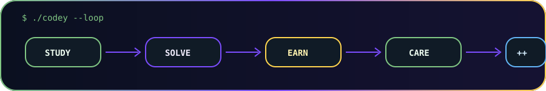
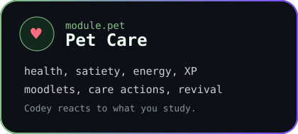
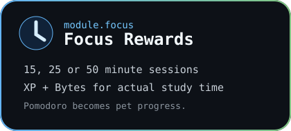
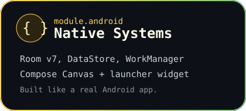
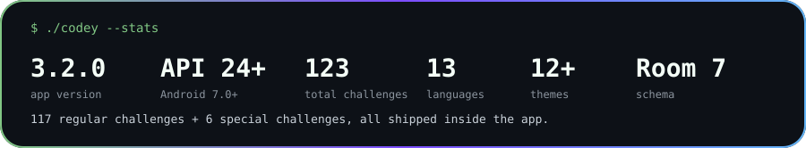

<div align="center">
  

  <h1>Code Tamagotchi</h1>

  <p><strong>Raise Codey while you learn to code.</strong></p>
  <p>Pomodoro sessions, coding challenges, arcade games and pet-care systems in a local-first Android app.</p>

  <p>
    <a href="https://github.com/fguzman-stack/CodePet/releases/latest"></a>
    <a href="#screenshots"></a>
  </p>

  

  <p><strong>English</strong> · <a href="README.es.md">Español</a></p>
</div>

---

<div align="center">
  <a href="#screenshots">Screenshots</a> ·
  <a href="#features">Features</a> ·
  <a href="#install">Install</a> ·
  <a href="#docs">Docs</a> ·
  <a href="#contribute">Contribute</a>
</div>

---

## What It Is

Code Tamagotchi turns programming practice into a pet-care loop. Study with Pomodoro, solve coding challenges, earn XP and Bytes, then use those rewards to keep Codey healthy, rested and evolving.

<div align="center">
  
</div>

The app is built for Android with Kotlin, Jetpack Compose, Room, DataStore, Koin and WorkManager, with Codey rendered procedurally instead of imported as sprite PNGs.

<a id="screenshots"></a>
## Screenshots

The project screenshots live in [`capturas_de_pantalla/`](capturas_de_pantalla/) and are shown here in their folder order.

<div align="center">
<table>
<tr>
<td align="center" width="33%"><a href="capturas_de_pantalla/captura_1.jpeg"></a><br/><sub><strong>01</strong> · Home and care</sub></td>
<td align="center" width="33%"><a href="capturas_de_pantalla/captura_2.jpeg"></a><br/><sub><strong>02</strong> · Coding challenges</sub></td>
<td align="center" width="33%"><a href="capturas_de_pantalla/captura_3.jpeg"></a><br/><sub><strong>03</strong> · Special challenges</sub></td>
</tr>
<tr>
<td align="center" width="33%"><a href="capturas_de_pantalla/captura_4.jpeg"></a><br/><sub><strong>04</strong> · Language badges</sub></td>
<td align="center" width="33%"><a href="capturas_de_pantalla/captura_5.jpeg"></a><br/><sub><strong>05</strong> · Focus mode</sub></td>
<td align="center" width="33%"><a href="capturas_de_pantalla/captura_6.jpeg"></a><br/><sub><strong>06</strong> · Shop and wardrobe</sub></td>
</tr>
</table>

<a href="capturas_de_pantalla/captura_7.jpeg"></a><br/>
<sub><strong>07</strong> · Matrix Green theme</sub>
</div>

<a id="features"></a>
## Features

<div align="center">
<table>
<tr>
<td width="50%"></td>
<td width="50%"></td>
</tr>
<tr>
<td width="50%"></td>
<td width="50%"></td>
</tr>
</table>
</div>

## Project Stats

<div align="center">
  
</div>

<a id="install"></a>
## Install

### I Just Want To Play

1. Download the APK from [Releases](https://github.com/fguzman-stack/CodePet/releases/latest).
2. Install it on Android 7.0 or newer.
3. Name Codey and start studying.

### I Want To Build It

```bash
git clone https://github.com/fguzman-stack/CodePet.git
cd CodePet
./gradlew :app:assembleDebug
adb install -r app/build/outputs/apk/debug/app-debug.apk
```

On Windows PowerShell, use `./gradlew.bat`.

<a id="docs"></a>
## Documentation

The long README content was split into focused docs:

| Guide | Use it for |
|:--|:--|
| [Getting Started](docs/GETTING_STARTED.md) | Build, install and run commands. |
| [Gameplay](docs/GAMEPLAY.md) | Pet loop, economy, themes and rewards. |
| [Architecture](docs/ARCHITECTURE.md) | Stack, package map and app wiring. |
| [Persistence](docs/PERSISTENCE.md) | Room, migrations and DataStore. |
| [Rendering](docs/RENDERING.md) | Codey, themes and widget rendering. |
| [Testing](docs/TESTING.md) | Unit, Robolectric, lint and screenshot tests. |
| [Localization](docs/LOCALIZATION.md) | Spanish/English resources and content. |
| [Roadmap](docs/ROADMAP.md) | Shipped features and next ideas. |

The older Spanish full reference is still available in [`documentacion.md`](documentacion.md).

<a id="contribute"></a>
## Contribute

The easiest contribution is adding or improving learning content:

- Add challenges for languages with smaller banks.
- Improve explanations in Codey's voice.
- Keep Spanish and English challenge entries synchronized.
- Report UI bugs with screenshots and device details.
- Suggest themes, wardrobe items or study rewards.

See [CONTRIBUTING.md](CONTRIBUTING.md) for the full contributor guide.

## License

MIT. Use it, fork it, adapt it and ship it; keep the copyright notice. See [LICENSE](LICENSE).

<div align="center">
  
  <p><strong>Code Tamagotchi</strong> · where bugs become pets and code becomes care.</p>
  <p><sub>Made from Chile by <a href="https://github.com/fguzman-stack">fguzman-stack</a>.</sub></p>
</div>
